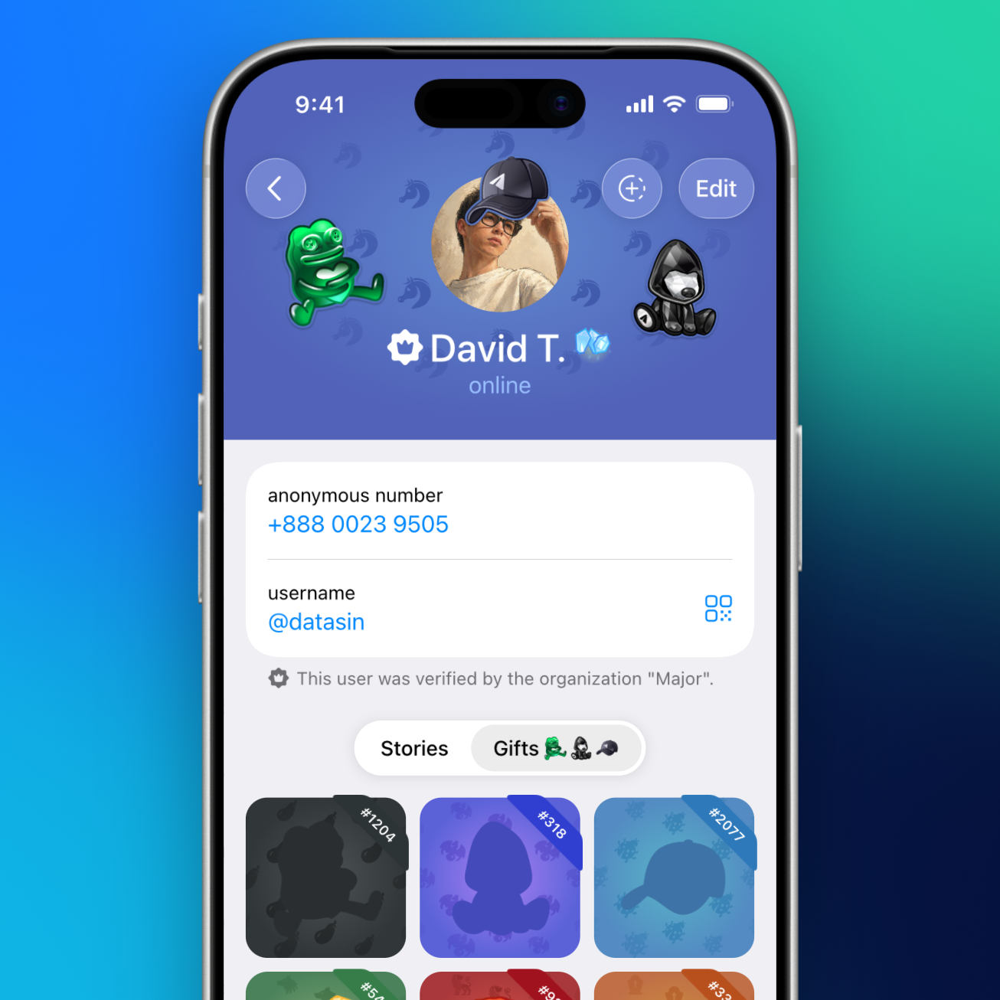

# Gift Stickers for Telegram iOS

Your gifts as stickers on your own profile. Long-press a collectible gift in the **Gifts** tab, peel it off and stick it anywhere on the profile header: next to your photo, on it, under your name. Change your mind and peel it off again.

[](Media/demo.mp4)

▶︎ [Media/demo.mp4](Media/demo.mp4) — the concept, animated (15 s, loops).

## Why

Collectible gifts are the most personal thing in a profile, and they live two taps away from it: in a grid, under a tab. The profile itself can show them only one way — up to twelve small icons that the app scatters around the avatar on its own.

The wallet card already lets you decorate it by hand: gifts become die-cut stickers that you peel, carry and lay down wherever you like. This concept brings the same gesture to the place where gifts are actually shown off. The profile stops being a layout you pick from a list and becomes something you arrange yourself.

## What it does

- **Peel a gift out of the grid.** Long-press a collectible gift in the Gifts tab of your own profile. The gift peels off its cell from the bottom edge up, grows under the finger and follows it, tilting with the speed of the drag.
- **Stick it onto the header.** Let go over the header and the sticker touches down and lies flat from its top edge to the bottom one, with a firm haptic tap at the moment of contact.
- **Move it, or take it off.** A sticker on the header peels off the same way. Carry it somewhere else, or let go outside the header and it flies back into its cell along a short arc.
- **A border in the profile's own colour.** Wallet stickers have a white die-cut border. Here the border takes the colour of the header under the sticker — the worn gift's backdrop, the profile colour, or the plain background — so a sticker looks like part of the profile, and the border shows only where it crosses the photo, the name or another sticker.
- **The cell remembers.** A gift that is out on the profile leaves a hollow of its own shape in its cell, tinted with the gift's backdrop. The gift is still in the grid; it is just not at home.
- **Stickers scroll with the header.** They travel with the bottom edge of the header and fade with it as the profile collapses under the navigation bar.
- **Up to ten stickers.**

## How it works

| Piece | Where |
| --- | --- |
| The sticker coordinator: gesture, motion, storage | `PeerInfoProfileGiftStickers.swift` (new) |
| The surface stickers lie on | `PeerInfoHeaderNode.swift` |
| Finding a gift's cell | `GiftsListView.swift`, `PeerInfoGiftsPaneNode.swift` |
| Sticker bitmaps for a gift outside a wallet | `WalletGiftStickerMedia.swift` |

- **The wallet's sticker, reused.** The peel shader (`WalletStickerWaveView`), the die-cut outline and the sticker bitmaps (`WalletGiftStickerMedia`) are the ones the wallet card uses. The timing is the same as well: 0.3 s to hold, 0.3 s to peel, 0.18 s to touch down, 0.42 s to lie flat. `WalletGiftStickerMedia` gets one more initializer, from a `StarGift.UniqueGift`, so a gift does not have to belong to a wallet.
- **One surface.** `PeerInfoHeaderNode` gets a `stickerSurfaceView` that keeps the header's resting size and is pinned to the bottom edge of the banner. Placements are stored as fractions of that surface, so they hold on any screen width.
- **The border colour.** The sticker's outline is drawn as a template image and tinted with the header's colour at the sticker's centre: a radial mix of the worn gift's inner and outer colours, the profile colour's gradient, or the theme's background. While a sticker is carried the colour follows it.
- **The long press.** One `UILongPressGestureRecognizer` on the profile's view, which only takes touches that start on a collectible gift's cell or on a sticker. When it begins on a cell, the cell's own long press (the context menu) is cancelled; a tap still opens the gift.
- **Storage.** In this concept the placements are kept on the device: one list per account in `UserDefaults`, keyed by the gift's slug. No API changes are needed to try it. A production version would keep them on the server next to the profile, the way the wallet card keeps its stickers, so that visitors see them too; only the load and save in the coordinator would change.

## Repository

| Path | What |
| --- | --- |
| `changes.patch` | The whole feature as one patch for Telegram-iOS: 7 files, +832 |
| `Sources/PeerInfoProfileGiftStickers.swift` | The new file from the patch, for reading |
| `Media/demo.mp4` | The concept, animated |

## Changes

| File | Change |
| --- | --- |
| `submodules/TelegramUI/Components/PeerInfo/PeerInfoScreen/Sources/PeerInfoProfileGiftStickers.swift` | New: the sticker coordinator |
| `submodules/TelegramUI/Components/PeerInfo/PeerInfoScreen/Sources/PeerInfoHeaderNode.swift` | The surface stickers lie on |
| `submodules/TelegramUI/Components/PeerInfo/PeerInfoScreen/Sources/PeerInfoScreen.swift` | Creates the coordinator on your own profile |
| `submodules/TelegramUI/Components/PeerInfo/PeerInfoScreen/BUILD` | Two dependencies |
| `submodules/TelegramUI/Components/PeerInfo/PeerInfoVisualMediaPaneNode/Sources/GiftsListView.swift` | The collectible gift under a point, the cell of a gift |
| `submodules/TelegramUI/Components/PeerInfo/PeerInfoVisualMediaPaneNode/Sources/PeerInfoGiftsPaneNode.swift` | The same, for the profile screen; locks the grid's scrolling during a drag |
| `submodules/TelegramUI/Components/Wallet/WalletGiftStickerMediaComponent/Sources/WalletGiftStickerMedia.swift` | An initializer from a collectible gift |

## Trying it

This is a change to the Telegram-iOS source tree, not a standalone app. Apply the patch to a checkout of [TelegramMessenger/Telegram-iOS](https://github.com/TelegramMessenger/Telegram-iOS) (made against `master` at `24638bc`, November 3, 2026) and build the app as usual:

```sh
git apply changes.patch
```

Open **Settings → My Profile**, go to the **Gifts** tab, long-press a collectible gift and carry it onto the header.

## Limitations

- **The video is the concept, not a screen recording.** The patch is its first implementation: it builds and the app runs with it, but the gesture has not been tuned on a device yet.
- **The stickers are local.** They live on this device only: other devices and a reinstall start with a clean profile, and visitors do not see them. See *Storage* above for the server-side version.
- **Collectible gifts only**, and only on your own profile, opened from Settings.
- **One size.** Stickers cannot be resized or turned with two fingers, as they can on the wallet card; the angle comes from the way the sticker was moving when you let go.
- **Stickers can cover the name and the buttons.** There are no keep-out zones yet.

## License

Telegram-iOS is distributed under the GNU General Public License v2.0, and so is this patch. See [LICENSE](LICENSE).
